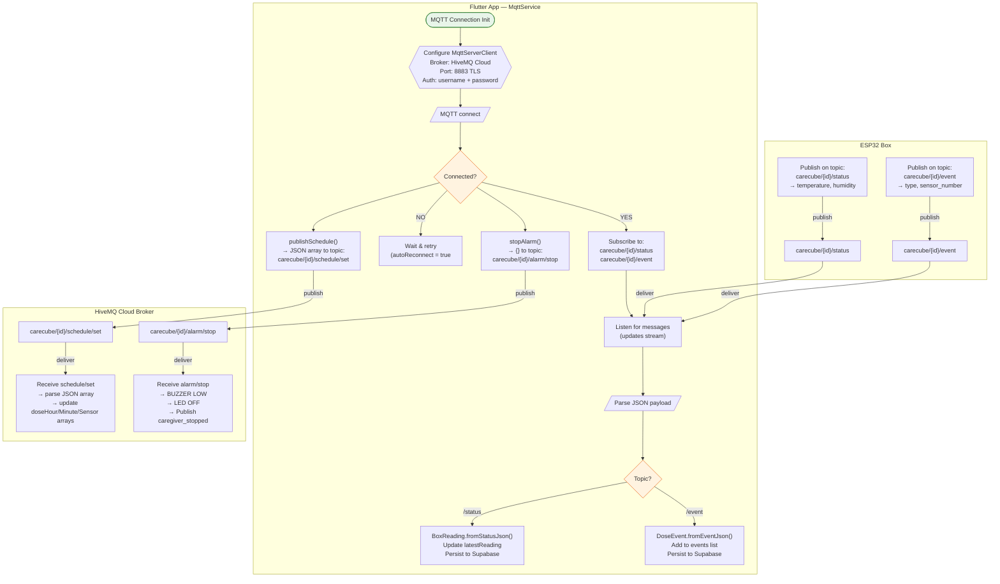
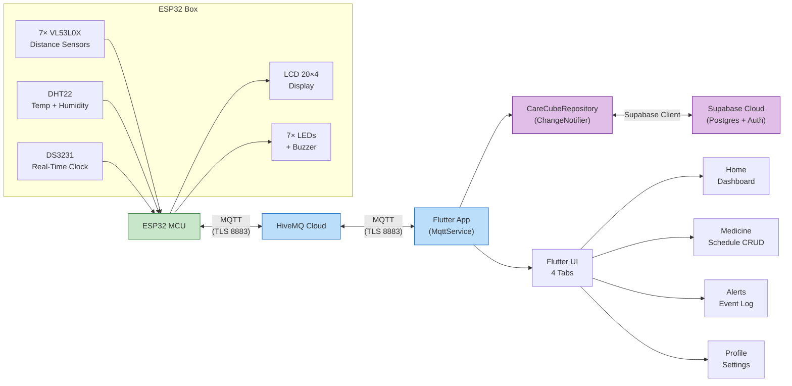

# Care Cube — Application Flowcharts

> Standard flowchart symbols used throughout:
>
> | Symbol | Shape | Meaning |
> |--------|-------|---------|
> | `([text])` | **Stadium** | Terminal (Start / End) |
> | `[text]` | **Rectangle** | Process / Action |
> | `{text?}` | **Diamond** | Decision (Yes / No) |
> | `[/text/]` | **Parallelogram** | Input / Output |
> | `[(text)]` | **Cylinder** | Database / Storage |
> | `{{text}}` | **Hexagon** | Preparation / Init |
> | `>text]` | **Asymmetric** | Display / Show |
> | `((text))` | **Circle** | Connector |

---

## 1. App Boot & Authentication

```mermaid
flowchart TD
    START(["Start App"])

    subgraph BOOT ["Boot Sequence"]
        START --> FLUTTER_INIT{{"Initialize Flutter bindings"}}
        FLUTTER_INIT --> SUPABASE_INIT["Init Supabase client"]
        SUPABASE_INIT --> NOTIF_INIT["Init Local Notifications"]
        NOTIF_INIT --> RUN_APP["Launch MaterialApp"]
    end

    RUN_APP --> CHECK_SESSION[/Read Supabase session/]

    CHECK_SESSION --> HAS_SESSION{Session exists?}

    HAS_SESSION -->|YES| FETCH_PROFILE[/Fetch profile from Supabase/]
    HAS_SESSION -->|NO| LOGIN_SCREEN

    FETCH_PROFILE --> PROFILE_OK{Profile found?}

    PROFILE_OK -->|YES| SET_PROFILE["AppState.setProfile(profile)"]
    PROFILE_OK -->|NO| SET_NULL["AppState.setProfile(null)"]

    SET_PROFILE --> GET_ROLE{Role?}
    SET_NULL --> LOGIN_SCREEN

    GET_ROLE -->|Patient| LOAD_PATIENT[/"repo.loadForPatient(userId)"/]
    GET_ROLE -->|Caregiver| LOAD_CAREGIVER[/"repo.loadForCaregiver(userId)"/]

    LOAD_PATIENT --> NAV_HOME["Navigate → /home"]
    LOAD_CAREGIVER --> NAV_HOME

    NAV_HOME --> END_OK(["End → MainShell"])

    LOGIN_SCREEN(["LoginScreen"])

    subgraph AUTH_FLOW ["Authentication"]
        LOGIN_SCREEN --> |"Enter email + password"| AUTH_CALL[/Supabase signIn/]
        AUTH_CALL --> AUTH_OK{Auth success?}
        AUTH_OK -->|NO| SHOW_ERR[>"Show error Snackbar"]
        SHOW_ERR --> LOGIN_SCREEN
        AUTH_OK -->|YES| FETCH_ROLE2[/Fetch profile role/]
        FETCH_ROLE2 --> LOAD_REPO["Load repo for role"]
        LOAD_REPO --> NAV_HOME

        LOGIN_SCREEN -->|"Tap 'Create account'"| SIGNUP_SCREEN
        SIGNUP_SCREEN(["SignUpScreen"])
        SIGNUP_SCREEN -->|"Enter name, email, password, role"| SIGNUP_CALL[/Supabase signUp/]
        SIGNUP_CALL --> SIGNUP_OK{Sign up success?}
        SIGNUP_OK -->|NO| SHOW_ERR2[>"Show error"]
        SHOW_ERR2 --> SIGNUP_SCREEN
        SIGNUP_OK -->|YES| SETUP_SCREEN
    end

    SETUP_SCREEN(["SetupWizardScreen"])

    subgraph SETUP_FLOW ["Onboarding Setup"]
        SETUP_SCREEN --> SETUP_ROLE{Role?}

        SETUP_ROLE -->|Patient| INPUT_DEVICE[/Enter device ID/]
        INPUT_DEVICE --> PAIR_BOX[/Supabase.pairBox/]
        PAIR_BOX --> LOAD_P2["repo.loadForPatient(userId)"]
        LOAD_P2 --> NAV_HOME

        SETUP_ROLE -->|Caregiver| INPUT_EMAIL[/Enter patient email/]
        INPUT_EMAIL --> LOOKUP_PATIENT[/Supabase: look up patient by email/]
        LOOKUP_PATIENT --> PAT_FOUND{Patient found?}
        PAT_FOUND -->|NO| SHOW_ERR3[>"Show error"]
        SHOW_ERR3 --> INPUT_EMAIL
        PAT_FOUND -->|YES| CREATE_LINK[/Supabase.createLink/]
        CREATE_LINK --> LOAD_C2["repo.loadForCaregiver(userId)"]
        LOAD_C2 --> NAV_HOME

        SETUP_ROLE -->|Skip| NAV_HOME
    end

    style START fill:#e8f5e9,stroke:#2e7d32
    style END_OK fill:#e8f5e9,stroke:#2e7d32
    style HAS_SESSION fill:#fff3e0,stroke:#e65100
    style GET_ROLE fill:#fff3e0,stroke:#e65100
    style SETUP_ROLE fill:#fff3e0,stroke:#e65100
    style PAT_FOUND fill:#fff3e0,stroke:#e65100
    style AUTH_OK fill:#fff3e0,stroke:#e65100
    style SIGNUP_OK fill:#fff3e0,stroke:#e65100
    style PROFILE_OK fill:#fff3e0,stroke:#e65100
```

---

## 2. MQTT Communication Layer



---

## 3. Home Screen Flow

```mermaid
flowchart TD
    HOME_START(["HomeScreen Build"])

    HOME_START --> READ_STATE["Read AppState\n• profile\n• repo.schedules\n• repo.events\n• repo.latestReading\n• repo.mqttConnected"]

    READ_STATE --> COMPUTE["Compute:\n• takenToday = count of 'taken' events\n• enabled = active schedules\n• nextDose = earliest upcoming\n• today = formatted date"]

    COMPUTE --> RENDER_HEADER[>"Render: Greeting + Date + Avatar"]
    RENDER_HEADER --> RENDER_CONN[>"Render: ConnectionStatusCard"]
    RENDER_CONN --> RENDER_PROGRESS[>"Render: DoseProgressCard (bar)"]
    RENDER_PROGRESS --> RENDER_NEXT[>"Render: NextDoseCard"]
    RENDER_NEXT --> RENDER_ACTIONS[>"Render: Quick Action buttons"]
    RENDER_ACTIONS --> RENDER_GRID[>"Render: 4-card grid\nTemp | Humidity | Device | Doses taken"]
    RENDER_GRID --> RENDER_DOSES[>"Render: Today's dose list\n(sorted by time, taken/pending pill)"]
    RENDER_DOSES --> HOME_END(["End"])

    QUICK_TAP["User taps Quick Action"] --> NAV{Which tab?}
    NAV -->|Medicine| TAB1["Switch to Medicine tab"]
    NAV -->|Events| TAB2["Switch to Alerts tab"]

    PULL["User pulls to refresh"] --> REFRESH["repo.refreshFromServer()\nReload schedules, events, readings\nfrom Supabase"]
    REFRESH --> HOME_START

    style HOME_START fill:#e8f5e9,stroke:#2e7d32
    style HOME_END fill:#e8f5e9,stroke:#2e7d32
```

---

## 4. Medicine Schedule CRUD Flow

```mermaid
flowchart TD
    MED_START(["MedicineScreen Build"])

    MED_START --> LOAD_DATA["Read repo.schedules"]
    LOAD_DATA --> EMPTY{Schedules empty?}

    EMPTY -->|YES| SHOW_EMPTY[>"Render: Empty state\nExplanation + 'Add first dose' button"]
    SHOW_EMPTY --> TAP_ADD_EMPTY["User taps 'Add first dose'"]

    EMPTY -->|NO| SHOW_SUMMARY[>"Render: Summary card\n(N scheduled, N active, 6 max)"]
    SHOW_SUMMARY --> SHOW_LIST[>"Render: Schedule tiles\nBay badge | Time | Enabled | Delete"]

    TAP_ADD_EMPTY --> OPEN_EDITOR
    TAP_TILE["User taps schedule tile"] --> OPEN_EDITOR
    TAP_ADD["User taps + button in AppBar"] --> OPEN_EDITOR

    OPEN_EDITOR["Open ScheduleEditor\n(Bottom Sheet)"]

    OPEN_EDITOR --> EDITOR_FIELDS

    subgraph EDITOR ["ScheduleEditor"]
        EDITOR_FIELDS["Pre-fill: label, sensor, time, enabled"]

        EDITOR_FIELDS --> EDIT_LABEL[/User edits label/]
        EDIT_LABEL --> EDIT_BAY[/User picks Bay 1-6\nOrange = already used/]
        EDIT_BAY --> EDIT_TIME[/User picks time via TimePicker/]
        EDIT_TIME --> EDIT_ENABLED[/User toggles enabled/]

        EDIT_ENABLED --> TAP_SAVE["User taps 'Save dose'"]
        TAP_SAVE --> VALIDATE{Valid input?}

        VALIDATE -->|NO| SHOW_ERR[>"Show error message"]
        SHOW_ERR --> EDITOR_FIELDS

        VALIDATE -->|YES| IS_NEW{New or update?}
    end

    IS_NEW -->|New| ADD_CALL[/repo.addSchedule(schedule)/]
    IS_NEW -->|Update| UPDATE_CALL[/repo.updateSchedule(id, schedule)/]

    ADD_CALL --> DB_INSERT[("Supabase INSERT\nschedules table")]
    UPDATE_CALL --> DB_UPDATE[("Supabase UPDATE\nschedules table")]

    DB_INSERT --> RELOAD["Reload schedules\nfrom Supabase"]
    DB_UPDATE --> RELOAD

    RELOAD --> PUSH_FIRMWARE["mqtt.publishSchedule()\nSend full 6-slot JSON array\nto ESP32"]
    PUSH_FIRMWARE --> CLOSE_EDITOR["Close bottom sheet\nShow 'synced to box' toast"]
    CLOSE_EDITOR --> MED_START

    DELETE_TAP["User taps delete icon"] --> CONFIRM{Confirm?}
    CONFIRM -->|YES| DEL_CALL[/repo.deleteSchedule(id)/]
    CONFIRM -->|NO| MED_START
    DEL_CALL --> DB_DELETE[("Supabase DELETE\nschedules table")]
    DB_DELETE --> RELOAD

    style MED_START fill:#e8f5e9,stroke:#2e7d32
```

---

## 5. Alert & Emergency Flow

```mermaid
flowchart TD
    ALERT_START(["AlertScreen Build"])

    ALERT_START --> READ_EVENTS["Read repo.events\nRead repo.hasActiveAlarm"]

    READ_EVENTS --> HAS_ALARM{hasActiveAlarm?}

    HAS_ALARM -->|YES| SHOW_BANNER[>"Render: Red alarm banner\n'MEDICINE ALARM ACTIVE'"]
    HAS_ALARM -->|NO| SKIP_BANNER

    SHOW_BANNER --> IS_CG{Is caregiver?}
    IS_CG -->|YES| SHOW_STOP["Render: 'Stop Alarm' button"]
    IS_CG -->|NO| SKIP_BANNER

    SHOW_STOP --> TAP_STOP["Caregiver taps 'Stop Alarm'"]
    TAP_STOP --> MQTT_STOP[/mqtt.stopAlarm()/]
    MQTT_STOP --> ESP_ALARM["ESP32 receives alarm/stop"]
    ESP_ALARM --> BUZZER_OFF["BUZZER = LOW"]
    ESP_ALARM --> LED_OFF["turnOffAllLEDs()"]
    ESP_ALARM --> PUB_EVENT[/Publish 'caregiver_stopped' event/]
    PUB_EVENT --> APP_RECEIVE["App receives event via MQTT"]
    APP_RECEIVE --> ADD_EVENT_LOG["Add to events list"]
    ADD_EVENT_LOG --> SNACKBAR[>"Show: 'Alarm stop sent to box'"]

    SKIP_BANNER --> EVENTS_EMPTY{Events empty?}

    EVENTS_EMPTY -->|YES| SHOW_EMPTY[>"Render: Empty state\nLegend chips for event types"]
    EVENTS_EMPTY -->|NO| SHOW_FEED

    subgraph FEED ["Event Feed"]
        SHOW_FEED["Render: Stats row\nTotal | Taken | Reminders | Emergency"]
        SHOW_FEED --> FILTER_CHIPS[>"Render: Filter chips\nAll | Reminders | Taken | Emergency"]
        FILTER_CHIPS --> APPLY_FILTER["Filter events list\nby selected category"]
        APPLY_FILTER --> RENDER_LIST[>"Render: Event tiles\nColored icon + type + sensor + time"]
    end

    ADD_EVENT_LOG --> ALERT_START

    style ALERT_START fill:#e8f5e9,stroke:#2e7d32
    style IS_CG fill:#fff3e0,stroke:#e65100
    style EVENTS_EMPTY fill:#fff3e0,stroke:#e65100
    style HAS_ALARM fill:#ffcdd2,stroke:#c62828
```

---

## 6. Profile Screen Flow

```mermaid
flowchart TD
    PROF_START(["ProfileScreen Build"])

    PROF_START --> READ_PROFILE["Read AppState.profile\nRead AppState.repo"]

    READ_PROFILE --> NULL_CHECK{profile == null?}

    NULL_CHECK -->|YES| LOADER[>"Render: CircularProgressIndicator"]
    NULL_CHECK -->|NO| RENDER_PROFILE

    subgraph PROFILE_VIEW ["Profile Content"]
        RENDER_PROFILE[>"Render: Avatar + Name + Email + Role chip"]

        RENDER_PROFILE --> BOX_SECTION[>"Render: Box & Connection card\nDevice ID | MQTT status | Last synced"]
        BOX_SECTION --> INFO_SECTION[>"Render: Personal info card\nPhone | DOB | Gender | Allergies\nBlood group | Emergency contact"]
        INFO_SECTION --> ROLE_SECTION{Role?}

        ROLE_SECTION -->|Caregiver| LINKS_CG["Render: Linked patients\n(FutureBuilder)\nPatient ID | Status chip"]
        ROLE_SECTION -->|Patient| LINKS_PAT["Render: Care team\n(FutureBuilder)\nCaregiver count | Status"]

        LINKS_CG --> EDIT_BTN
        LINKS_PAT --> EDIT_BTN
    end

    EDIT_BTN[>"Render: 'Edit profile' button"]
    EDIT_BTN --> TAP_EDIT["User taps 'Edit profile'"]
    TAP_EDIT --> NAV_EDIT["Navigate → EditProfileScreen"]

    subgraph EDIT_PROFILE ["EditProfileScreen"]
        NAV_EDIT --> EDIT_FIELDS["Pre-fill all form fields"]
        EDIT_FIELDS --> MODIFY[/"User modifies fields\nName, Phone, DOB, Gender,\nAllergies, Blood group,\nEmergency contact"/]
        MODIFY --> SAVE_BTN["User taps 'Save'"]
        SAVE_BTN --> FORM_OK{Valid?}
        FORM_OK -->|NO| SHOW_ERR[>"Show validation error"]
        SHOW_ERR --> EDIT_FIELDS
        FORM_OK -->|YES| UPSERT_DB[/Supabase UPSERT profile/]
        UPSERT_DB --> REFRESH_LOCAL["AppState.reloadProfile()\nFetch updated profile from DB"]
        REFRESH_LOCAL --> POP_BACK["Navigator.pop()\n'Profile saved' snackbar"]
    end

    POP_BACK --> PROF_START

    SIGNOUT["User taps 'Sign out'"] --> AUTH_SIGNOUT[/Supabase.signOut()/]
    AUTH_SIGNOUT --> CLEAR_APP["AppState.clear()\nReset repo"]
    CLEAR_APP --> NAV_LOGIN["Navigate → /login\n(clear navigation stack)"]

    PROF_START --> SIGNOUT

    style PROF_START fill:#e8f5e9,stroke:#2e7d32
    style NULL_CHECK fill:#fff3e0,stroke:#e65100
    style ROLE_SECTION fill:#fff3e0,stroke:#e65100
    style FORM_OK fill:#fff3e0,stroke:#e65100
```

---

## 7. ESP32 Firmware State Machine

```mermaid
flowchart TD
    ESP_START(["ESP32 Power On"])

    subgraph INIT ["Initialization Sequence"]
        ESP_START --> INIT_IO{{"Init I2C bus (SDA=21, SCL=22)\nInit all LED pins as OUTPUT\nInit Buzzer pin as OUTPUT"}}
        INIT_IO --> INIT_DHT["Init DHT22 sensor\non GPIO16"]
        INIT_DHT --> INIT_XSHUT{{"Set all XSHUT pins LOW\n(Power off all VL53L0X)"}}
        INIT_XSHUT --> INIT_SENSORS["Init 7 VL53L0X sensors\nSequentially enable each\nvia XSHUT HIGH\nAssign I2C addresses\n0x30 - 0x36"]

        INIT_SENSORS --> INIT_RTC{RTC available?}
        INIT_RTC -->|NO| RTC_ERR[>"Display: RTC NOT FOUND!"]
        RTC_ERR --> HALT(["HALT"])
        INIT_RTC -->|YES| RTC_CHECK{Lost power?}
        RTC_CHECK -->|YES| RTC_ADJUST["RTC.adjust\n(compile time)"]
        RTC_CHECK -->|NO| INIT_LCD
        RTC_ADJUST --> INIT_LCD

        INIT_LCD["Init LCD 20x4\nDisplay: 'CARE CUBE\nMEDICINE SYSTEM\nSYSTEM READY'"]
        INIT_LCD --> WIFI_CONN[/WiFi.begin()/]
        WIFI_CONN --> WIFI_OK{Connected?}
        WIFI_OK -->|NO| WIFI_ERR[>"Display: WiFi FAILED!"]
        WIFI_ERR --> MQTT_INIT
        WIFI_OK -->|YES| WIFI_SHOW[>"Display: WiFi Connected\n+ IP address"]

        WIFI_SHOW --> MQTT_INIT{{"Set MQTT broker\nSet callback\nSubscribe to:\nschedule/set + alarm/stop"}}
        MQTT_INIT --> MQTT_CONNECT[/mqttClient.connect()/]
        MQTT_CONNECT --> MQTT_OK{Connected?}
        MQTT_OK -->|NO| MQTT_ERR["Log: MQTT failed"]
        MQTT_OK -->|YES| MQTT_LOG["Log: MQTT connected\nLog subscribed topics"]
        MQTT_ERR --> READ_INIT
        MQTT_LOG --> READ_INIT
        MQTT_INIT --> READ_INIT
        READ_INIT["Read initial S7 distance\n(prevents false emergency)"]
    end

    READ_INIT --> LOOP(["Main Loop Start"])

    LOOP --> MQTT_LOOP["mqttClient.loop()\n(Process incoming messages)"]

    MQTT_LOOP --> WIFI_CHECK{WiFi connected?}
    WIFI_CHECK -->|NO| WIFI_RECONNECT[/WiFi.reconnect()/]
    WIFI_RECONNECT --> MQTT_CHECK
    WIFI_CHECK -->|YES| MQTT_CHECK

    MQTT_CHECK{MQTT connected?}
    MQTT_CHECK -->|NO| MQTT_RECONNECT[/reconnectMQTT()/]
    MQTT_RECONNECT --> READ_SENSORS
    MQTT_CHECK -->|YES| READ_SENSORS

    READ_SENSORS[/Read all 7 VL53L0X sensors/]
    READ_SENSORS --> READ_DHT[/Read DHT22 every 2 seconds/]

    READ_DHT --> MIDNIGHT{Midnight?}
    MIDNIGHT -->|YES| RESET_FLAGS["Reset all\ndoseTriggered[] = false"]
    MIDNIGHT -->|NO| PUBLISH_CHECK
    RESET_FLAGS --> PUBLISH_CHECK

    PUBLISH_CHECK{30s elapsed?}
    PUBLISH_CHECK -->|YES| PUB_STATUS[/Publish status JSON\ntemperature + humidity/]
    PUBLISH_CHECK -->|NO| EMERGENCY_CHECK
    PUB_STATUS --> EMERGENCY_CHECK

    subgraph EMERGENCY_DETECT ["Emergency Detection"]
        EMERGENCY_CHECK["Check S7:\nPrevious <= 90mm AND\nCurrent > 90mm"]
        EMERGENCY_CHECK --> EMER_READY{Not in reminder\nAND main screen\nAND not triggered?}
        EMER_READY -->|YES| EMER_ACTIVE["Set emergencyTriggered = true\nturnOnLED(7)\nBUZZER = HIGH\nPublish 'emergency_taken'"]
        EMER_READY -->|NO| SAVE_PREV
        EMER_ACTIVE --> EMER_DISPLAY[>"Display: 'ATTENTION!\nEMERGENCY DOSE\nTAKEN!'"]
        EMER_DISPLAY --> EMER_LOOP["Timer: buzzer + LED\nfor 60 seconds"]
        EMER_LOOP --> EMER_DONE{60s elapsed?}
        EMER_DONE -->|NO| SAVE_PREV
        EMER_DONE -->|YES| EMER_CLEAR["BUZZER = LOW\nLED OFF\nemergencyTriggered = false\nBack to MAIN_SCREEN"]
    end

    SAVE_PREV["Save current S7 as\npreviousDistance7"]

    SAVE_PREV --> DOSE_CHECK

    subgraph DOSE_REMINDER ["Dose Reminder Logic"]
        DOSE_CHECK["Check all 6 dose slots"]
        DOSE_CHECK --> DOSE_HIT{Any enabled dose\ntime matches now\nAND not triggered?}
        DOSE_HIT -->|YES| DOSE_TRIGGER["Set doseTriggered[i] = true\nturnOnLED(doseSensor[i])\nBUZZER = HIGH\nPublish 'reminder_started'"]
        DOSE_HIT -->|NO| MED_TAKEN_CHECK
        DOSE_TRIGGER --> REMINDER_DISP[>"Display: '!! REMINDER !!\nTAKE MEDICINE\nSENSOR X'"]
        REMINDER_DISP --> SENSOR_CHECK["Read sensor for\nactive dose bay"]
        SENSOR_CHECK --> ABOVE{Distance > 90mm?}

        ABOVE -->|YES| CONFIRM_COUNT["medicineTakenCount++"]
        CONFIRM_COUNT --> CONFIRM_OK{Count >= 3?}
        CONFIRM_OK -->|NO| MED_TAKEN_CHECK
        CONFIRM_OK -->|YES| TAKEN_CONFIRM["BUZZER = LOW\nturnOnLED(sensor)\nPublish 'taken'"]
        TAKEN_CONFIRM --> TAKEN_DISP[>"Display: 'MEDICINE\nTAKEN\nSENSOR X\nWELL DONE!'"]
        TAKEN_DISP --> TAKEN_TIMER["Timer: LED on\nfor 30 seconds"]
        TAKEN_TIMER --> TAKEN_DONE{30s elapsed?}
        TAKEN_DONE -->|NO| MED_TAKEN_CHECK
        TAKEN_DONE -->|YES| TAKEN_CLEAR["LED OFF\nactiveReminder = -1\nBack to MAIN_SCREEN"]

        ABOVE -->|NO| RESET_COUNT["medicineTakenCount = 0\nBUZZER = HIGH\nKeep LED ON\nUpdate reminder display"]
    end

    MED_TAKEN_CHECK --> MAIN_SCREEN

    subgraph MAIN_UPDATE ["Main Screen Update"]
        MAIN_SCREEN["Main screen mode"]
        MAIN_SCREEN --> MAIN_LCD{"500ms elapsed?"}
        MAIN_LCD -->|YES| LCD_UPDATE[>"Update LCD:\nTime | WiFi/MQTT status\nDate\nTemp | Humidity\nNext dose time"]
        MAIN_LCD -->|NO| SERIAL
        LCD_UPDATE --> SERIAL
    end

    SERIAL[/Serial Monitor output:\nTime | Temp | Humidity\nMQTT | S1-S7 distances/]
    SERIAL --> LOOP_DELAY["delay(500ms)"]
    LOOP_DELAY --> LOOP

    style ESP_START fill:#e8f5e9,stroke:#2e7d32
    style HALT fill:#ffcdd2,stroke:#c62828
    style LOOP fill:#e3f2fd,stroke:#1565c0
    style WIFI_OK fill:#fff3e0,stroke:#e65100
    style MQTT_OK fill:#fff3e0,stroke:#e65100
    style DOSE_HIT fill:#fff3e0,stroke:#e65100
    style ABOVE fill:#fff3e0,stroke:#e65100
    style CONFIRM_OK fill:#fff3e0,stroke:#e65100
    style EMER_READY fill:#ffcdd2,stroke:#c62828
    style EMER_DONE fill:#fff3e0,stroke:#e65100
    style TAKEN_DONE fill:#fff3e0,stroke:#e65100
    style MIDNIGHT fill:#fff3e0,stroke:#e65100
    style WIFI_CHECK fill:#fff3e0,stroke:#e65100
    style MQTT_CHECK fill:#fff3e0,stroke:#e65100
    style PUBLISH_CHECK fill:#fff3e0,stroke:#e65100
    style RTC_CHECK fill:#fff3e0,stroke:#e65100
    style RTC_ERR fill:#ffcdd2,stroke:#c62828
```

---

## 8. Schedule Push to Firmware

```mermaid
flowchart TD
    USER_ACTION["User adds / edits / deletes a dose"]

    USER_ACTION --> DB_WRITE[("Supabase\nINSERT / UPDATE / DELETE")]
    DB_WRITE --> RELOAD["Reload schedules\nfrom Supabase"]
    RELOAD --> BUILD_ARRAY["Build full 6-slot JSON array:\n[\n  {slot:0, sensor_number:1, hour:8, minute:0, enabled:true},\n  {slot:1, sensor_number:2, hour:10, minute:0, enabled:true},\n  ...,\n  {slot:5, sensor_number:6, hour:20, minute:0, enabled:false}\n]"]

    BUILD_ARRAY --> PUBLISH[/mqtt.publishSchedule()\nto carecube\/{id}\/schedule/set/]
    PUBLISH --> BROKER["HiveMQ Cloud Broker"]
    BROKER --> ESP接收["ESP32 receives message"]

    ESP接收 --> PARSE["mqttCallback()\nArduinoJson: deserializeJson()"]
    PARSE --> ITERATE["For each slot 0-5:\ndoseHour[i] = hour\ndoseMinute[i] = minute\ndoseSensor[i] = sensor_number\ndoseEnabled[i] = enabled"]

    ITERATE --> LOG["Serial.print each slot\nSchedule updated via MQTT"]

    style USER_ACTION fill:#e8f5e9,stroke:#2e7d32
    style DB_WRITE fill:#e3f2fd,stroke:#1565c0
    style BROKER fill:#e3f2fd,stroke:#1565c0
    style LOG fill:#e8f5e9,stroke:#2e7d32
```

---

## 9. Data Flow Overview



---

*Generated for Care Cube v1.0 — all flows verified against source code.*
